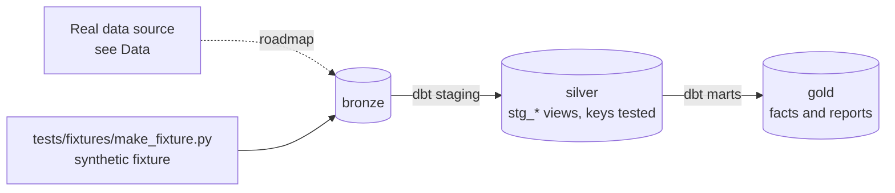

# Device Fleet Reliability Lakehouse

[](https://github.com/Saigwe/device-fleet-reliability/actions/workflows/ci.yml)

> Estate-wide reliability for a device fleet: multi-source ingestion, failure rates normalised per 1,000 units, survival curves and end-of-life planning, with a governed data catalogue.

**Author:** Stanley Igwe, Lead Data (Analytics) Engineer · [Portfolio](https://saigwe.github.io)
**Stack:** dlt (ingestion from Postgres, MongoDB and JSON) · DuckDB / MotherDuck or BigQuery · dbt Core · lifelines (survival analysis) · OpenMetadata or DataHub · Evidence.dev
**Status:** 🚧 Scaffolded. Fixture pipeline passes: `dbt build` 18/18. See [Roadmap](#roadmap).

Project 5 of my portfolio plan. At a workplace-communications hardware company I profiled 56 tables across PostgreSQL, MongoDB and JSON, built the data dictionary, and delivered estate-wide reporting over ~680k devices with failure rates normalised per 1,000 units for end-of-life planning, cutting selected reporting from ~1 day to ~1 hour. This repo rebuilds the problem on public and synthetic data. No employer or client data, code or logic is used.

---

## 90-second summary
| | |
|---|---|
| **Problem** | TODO: one sentence on the business problem. |
| **What I built** | TODO: fill in as the roadmap lands. |
| **Why it matters** | TODO: the decision this enables, in the user's words. |
| **Proof** | TODO: link to [Numbers](#numbers), with every claim reproducible. |

## Architecture


## Data
Real data: [Backblaze hard-drive test data](https://www.backblaze.com/cloud-storage/resources/hard-drive-test-data), with daily status for 300k+ drives and a failure flag. Load part into Postgres and part into MongoDB to mirror mixed sources. CI uses a small synthetic fleet with the same shape.

| Bronze table (fixture) | Rows |
|---|---|
| `bronze.sites` | 20 |
| `bronze.devices` | 800 |
| `bronze.device_days` | one per device per `D` period, 2025-01-01 to 2025-03-31 |

## Data model (gold layer, first cut)
| Model | Purpose |
|---|---|
| `fct_device_day` | One row per device per day, with model, site and age; days after a device's first failure are excluded. |
| `rpt_failure_rate_by_model` | Annualised failure rate (AFR) and failures per 1,000 units, by model. |

## Tests in place
- Staging: `unique` / `not_null` on every key, and `relationships` on every foreign key
- Marts: grain tests (`unique_combination`) and accepted values
- Business rules: `assert_failure_rates_in_range`

## Numbers
*(Fill from real runs. Never estimate.)*
| Metric | Value |
|---|---|
| Rows processed (real data) | _tbd_ |
| dbt models / tests | _tbd_ |
| `dbt build` runtime | _tbd_ |

## How to run
Requires **Python 3.12** (what CI uses) and `make`, or run the commands in the `Makefile` by hand.
```bash
python -m venv .venv && source .venv/bin/activate   # Windows: .venv\Scripts\activate
pip install -r requirements.txt
make fixture-all   # synthetic fixture -> dbt build (used in CI)
```

## Roadmap
- [x] Scaffold: synthetic fixture, staging with key tests, first marts and business-rule tests, CI
- [ ] Write a Backblaze loader that puts one quarter into Postgres and MongoDB, and the rest into JSON files
- [ ] Ingest all three with dlt into bronze; conform device, model and site keys in silver
- [ ] Gold: `fct_device_day` and annualised failure rate per 1,000 units by model and age
- [ ] Kaplan-Meier survival curves and an end-of-life replacement forecast
- [ ] Fold in project 6: auto-profiling, lineage in OpenMetadata, owners and PII tags, and dbt contracts that fail CI on breaking schema changes
- [ ] Evidence.dev reliability dashboard and timings from raw to dashboard
- [ ] Fill in [Numbers](#numbers) and the [design doc](docs/design_doc.md)
- [ ] 3-minute Loom walkthrough

## Interview topics this project prepares
- Multi-source ingestion
- Normalised rates and denominators
- Survival analysis basics
- Data governance and lineage

## Data and licence
- **Fixture:** synthetic, generated with a fixed seed by `tests/fixtures/make_fixture.py` from `fixture_spec.yml`. It describes no real company or person.
- **Real data:** see [Data](#data) for each source's own licence and terms.
- **Code:** MIT (see `LICENSE`).
