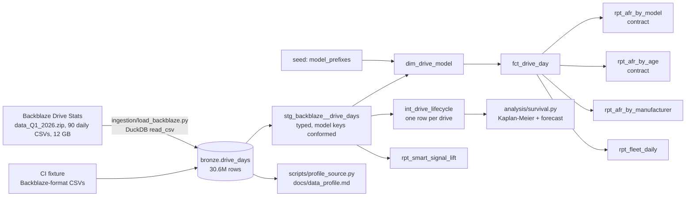
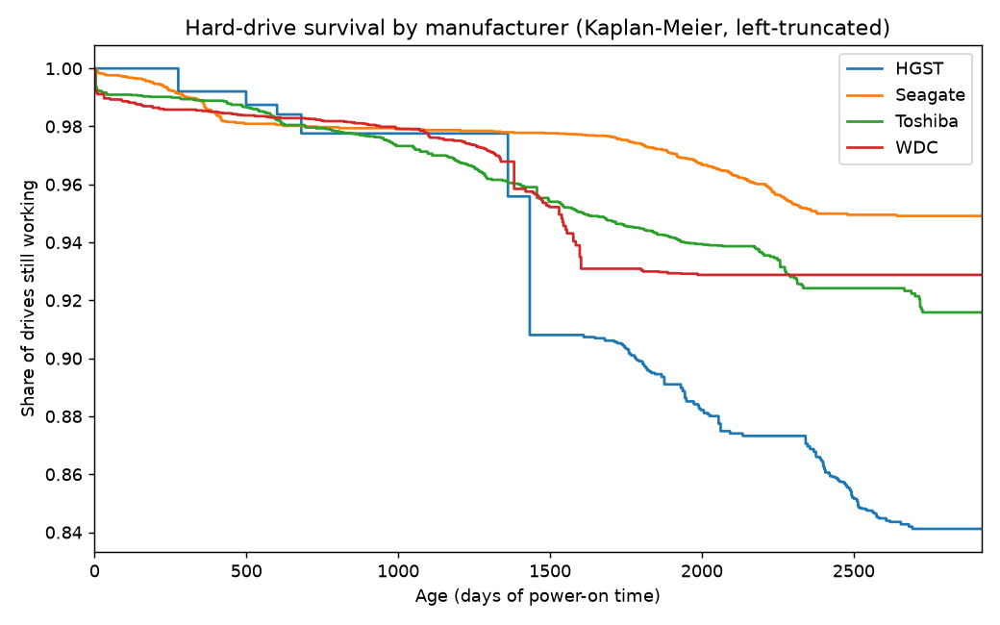

# Device Fleet Reliability

[](https://github.com/Saigwe/device-fleet-reliability/actions/workflows/ci.yml)

> Fleet reliability on real data: 30.6 million drive-days from Backblaze's 351,000-drive fleet (Q1 2026), turned into annualised failure rates with confidence intervals, failures per 1,000 units, the age "bathtub" curve, survival curves, a next-quarter replacement forecast and the SMART signals that warn before failure.

**Author:** Stanley Igwe, Lead Data (Analytics) Engineer · [Portfolio](https://saigwe.github.io)
**Stack:** Python · DuckDB · dbt Core (contracts, unit tests, meta) · lifelines · matplotlib · GitHub Actions
**Status:** Core build complete on one real quarter. See [Roadmap](#roadmap) for the multi-database ingestion and the forecast back-test.

Based on work I led at a workplace-communications hardware company:
- profiling 56 tables across PostgreSQL, MongoDB and JSON
- building the data dictionary
- estate-wide reporting over ~680k devices, with failure rates normalised per 1,000 units for end-of-life planning

This repo applies the same approach to Backblaze's public hard-drive data; no employer data is used.

---

## 90-second summary
| | |
|---|---|
| **Problem** | A fleet team needs to know which device models fail most, how failure changes with age, and how many units to replace next quarter. Raw daily device status is too big and messy to answer that by hand. |
| **What I built** | A DuckDB + dbt pipeline over Backblaze's daily drive status: conformed model keys, a drive-day fact, AFR by model, age and manufacturer (with intervals and reporting thresholds), SMART-signal lift, Kaplan–Meier survival with left truncation, and a per-model replacement forecast. Governance comes with it: owners, classifications, enforced contracts, a source profile and lineage. |
| **Why it matters** | Retire or watch the right models, plan spares from expected failures rather than guesses, and trust the numbers because they reconcile and their contracts are enforced. |
| **Proof** | 30,597,484 rows load in 23 s. dbt runs 30 checks in 21 s. Every report reconciles to the same drive-days and failures. See [Numbers](#numbers). |

## Architecture


## Definitions
- **AFR (annualised failure rate)** = failures ÷ (drive-days ÷ 365) × 100. This is Backblaze's own definition.
- **Interval:** an approximate 95% interval treating failures as Poisson.
- **Reporting threshold:** the model needs ≥ 100 drives and ≥ 10,000 drive-days, mirroring Backblaze's publication rule. 35 of 57 hard-drive models qualify.
- **Failures per 1,000 drives** = failures ÷ distinct drives × 1,000. This is the normalisation I used for end-of-life planning at work.
- **Age** = power-on hours (SMART 9), because the data has no install date. A few Seagate desktop models report SMART 9 in vendor-specific ways, so their ages are approximate.
- **Hard drives only:** 3,441 boot SSDs are excluded from AFR, as in Backblaze's HDD reports. Drive type comes from a prefix seed with longest-match rules.

## Governance (project 6 of my plan, folded in)
- **Ownership and classification:** recorded as dbt `meta` on every layer (`owner: reliability-analytics`, internal for silver, public for gold). Serial numbers are documented as equipment identifiers, not personal data.
- **Contracts:** enforced on `rpt_afr_by_model` and `rpt_afr_by_age`. A breaking change to a column name or type fails CI before it reaches a dashboard.
- **Conformed keys:** 476 drives report their model without the `WDC ` prefix (`WUH721816ALE6L4`). Silver conforms them, keeps `raw_model`, and a test fails if a bare part number reappears.
- **Source profile:** `docs/data_profile.md` lists types, ranges, distinct counts and null rates for every loaded column.
- **Lineage:** `make docs` generates the dbt catalogue and lineage graph (`dbt docs serve` to browse).
- **Source-quality checks** (warnings, so the pipeline keeps running while issues are listed):
  - duplicate drive-days
  - drives that report again after failing
  - both are zero in Q1 2026

## Tests
- **Reconciliation:** the by-model, by-age and by-manufacturer reports each add up to the fact's hard-drive days and failures.
- **Unit tests:**
  - longest-prefix manufacturer and drive-type matching, with an "Other" default
  - drive lifecycle (failure date, age at entry and exit)
- **Contracts and generic tests:** keys, accepted values, the interval brackets its estimate, conformed model names.
- **CI fixture:** CI writes Backblaze-format CSVs, including SMART columns the loader ignores, and runs the real loader, dbt, the survival analysis and the profiler on them.

## Numbers
All from the real Q1 2026 data on a Windows laptop. Reproduce with `make all`, which downloads 1.31 GB.

| Metric | Value |
|---|---|
| Rows / days / drives / failures (all drives) | 30,597,484 / 90 / 351,095 / 1,030 |
| Hard drives / hard-drive days / failures | 347,654 / 30,291,786 / 1,030 |
| **Fleet hard-drive AFR** | **1.24%** |
| Load (DuckDB, 90 CSVs) / `dbt build` | 23 s (50 s with unzip) / 21 s, all 30 checks passing |

**AFR by manufacturer:**

| Manufacturer | Drives | Failures | AFR |
|---|---|---|---|
| Toshiba | 117,902 | 294 | 1.05% |
| Seagate | 114,976 | 406 | 1.47% |
| WDC | 87,771 | 141 | 0.67% |
| HGST | 27,005 | 189 | 2.87% |

**Largest models (AFR with 95% interval):**

| Model | Drives | Failures | AFR | Interval |
|---|---|---|---|---|
| WDC WUH722222ALE6L4 | 45,638 | 42 | 0.38% | 0.27–0.50% |
| TOSHIBA MG08ACA16TA | 40,036 | 102 | 1.05% | 0.85–1.25% |
| TOSHIBA MG07ACA14TA | 37,263 | 94 | 1.03% | 0.82–1.23% |
| ST16000NM001G | 34,729 | 44 | 0.52% | 0.37–0.67% |
| WDC WUH721816ALE6L4 | 26,801 | 64 | 0.97% | 0.73–1.21% |
| ST12000NM0008 | 18,650 | 129 | 2.83% | 2.34–3.32% |
| HGST HUH721212ALE604 | 13,277 | 86 | 2.65% | 2.09–3.21% |

The highest AFRs among models with 10+ failures are ST14000NM0138 (4.90%), ST10000NM0086 (4.63%) and ST12000NM0007 (4.59%). Each has about 1,000 drives, so their intervals are wide (roughly 2–7%).

**AFR by age (the bathtub):**

| Age (years) | 0 | 1 | 2 | 3 | 4 | 5 | 6 | 7 | 8 |
|---|---|---|---|---|---|---|---|---|---|
| AFR | 1.02% | 0.64% | 0.57% | 1.23% | 1.33% | 1.29% | 3.69% | 2.22% | 1.24% |

Failure is elevated in the first year, lowest at 1–2 years, and rises from year 3, peaking at year 6. The dip after 6 most likely reflects survivors: drives still running at 7–8 years tend to be the robust ones, and the oldest models have mostly been retired.

**Which SMART stats warn of failure** (share of drives with a non-zero value on their last day):

| SMART stat | Failed drives | Surviving drives | Lift |
|---|---|---|---|
| 198 Offline uncorrectable | 42.5% | 1.49% | 28.5× |
| 197 Pending sectors | 59.7% | 2.13% | 28.0× |
| 187 Reported uncorrectable | 27.8% | 1.59% | 17.4× |
| 5 Reallocated sectors | 62.9% | 5.41% | 11.6× |
| 188 Command timeouts | 20.6% | 2.22% | 9.3× |

**Survival and replacement forecast** ([full table](results/survival.md)): left-truncated Kaplan–Meier puts the fleet at 97.0% still working at 4 years and 91.9% at 8. For the 342,246 drives in service at quarter end, the forecast expects **914 failures in the next 90 days**, against 1,027 observed this quarter. The top contributors are HGST HUH721212ALE604 (132 expected, 10.1 per 1,000 drives) and TOSHIBA MG08ACA16TA (108).



Read the curves with care. One quarter of left-truncated data gives few drives at some ages. HGST's sharp step near 1,400 days is a handful of failures among few drives at that age, not a cliff. More quarters would smooth this, and that's next on the roadmap.

## How to run
Requires **Python 3.12** (what CI uses) and `make`, or run the commands in the `Makefile` by hand.
```bash
python -m venv .venv && source .venv/bin/activate   # Windows: .venv\Scripts\activate
pip install -r requirements.txt
make all            # download Q1 2026 (1.31 GB) -> load -> dbt build -> survival -> profile -> docs
make all QUARTER=Q2_2026
make fixture-all    # Backblaze-format fixture, no download (CI)
```

## Roadmap
- [x] Loader for Backblaze's daily CSVs (DuckDB, header-tolerant) and a Backblaze-format CI fixture
- [x] Conformed model keys in silver; drive-day fact; AFR by model, age and manufacturer with intervals and reporting thresholds
- [x] Kaplan–Meier survival with left truncation; per-model replacement forecast
- [x] Governance: owners and classifications, contracts, source profile, lineage, source-quality warnings
- [ ] Back-test the forecast against Q2 2026 actuals (914 expected vs observed)
- [ ] Multiple quarters (a full year) for smoother survival curves
- [ ] Mixed-source ingestion as at work: part of the data in Postgres and MongoDB, ingested with dlt (needs Docker, which isn't on my build machine)
- [ ] OpenMetadata catalogue and an Evidence.dev reliability dashboard
- [ ] Design doc and a 3-minute walkthrough

## Interview topics this project prepares
- Normalised failure metrics and choosing the right denominator
- Survival analysis with left truncation (survivorship bias)
- Processing 30M+ rows locally with DuckDB
- Data contracts, conformed keys and source-quality checks
- Communicating uncertainty: intervals and noisy curves

## Data and licence
- **Data:** [Backblaze Drive Stats](https://www.backblaze.com/cloud-storage/resources/hard-drive-test-data), © Backblaze. Backblaze asks that you cite them as the source, accept that you're solely responsible for how you use the data, and don't sell it. The raw files are not committed (`data/` is gitignored).
- **Code:** MIT (see `LICENSE`).
